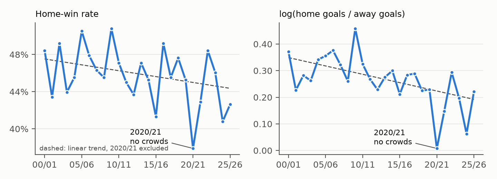
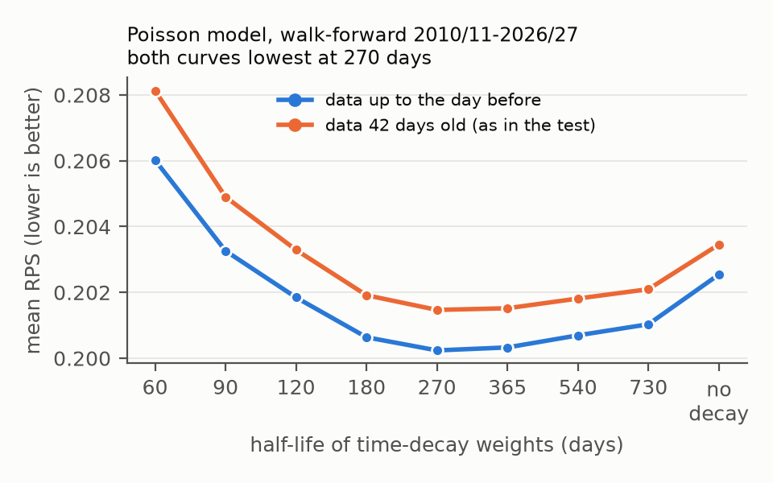

# Time Structure and Non-Stationarity: Issues T1–T6

English version of `time_structure.md` (11 November 2026).

This document answers Part 2 of the problem list (T1–T6). Each issue is presented as **finding → conclusion → what to do → what to write in the report**.

Every number comes from scripts that have been run on the cleaned data `cleaning/out/matches_clean.csv` (see `data_cleaning_en.md`).

| Script | Content | Run time |
|---|---|---|
| [time_structure/t_elo.py](time_structure/t_elo.py) | Descriptive statistics for T1, T2, T4, T5, T6; Elo grid over K, H, λ; closed-doors treatments; forecast horizon | ~5 s |
| [time_structure/t_decay.py](time_structure/t_decay.py) | T3 half-life grid; T4 extra down-weighting δ across seasons; horizons of 0 and 42 days | ~30 s |
| [time_structure/t_covid_poisson.py](time_structure/t_covid_poisson.py) | T2: three treatments of closed-doors matches in the Poisson model | ~5 s |
| [time_structure/t_jan_draw.py](time_structure/t_jan_draw.py) | T5: can the different draw rates in January, over Christmas and in March be used for prediction? | ~5 s |
| [time_structure/t_figures.py](time_structure/t_figures.py) | Two figures for the report (PNG and PDF) | – |

Results are in `time_structure/out/`; the `*_results.json` files contain every number.

How to run (from `Group Coursework/`):

```bash
python3 -I time_structure/t_elo.py cleaning/out/matches_clean.csv time_structure/out
```

The other three analysis scripts take the same arguments.

---

## Common evaluation protocol (identical for all experiments)

- **Walk-forward validation.** Each evaluation season uses only data before it, and no evaluation season is ever used to choose parameters (problem list, V1 and V2).
- **The main metric is the RPS**, the score used by the coursework; lower is better. The frequency baseline, which gives every match the home/draw/away shares of the previous five seasons, scores 0.2292.
- **Elo model**:
  - the published elofootball method (K, home advantage H, goal-difference multiplier), optionally with season shrinkage λ;
  - an ordered logit maps the rating difference d to three probabilities, fitted on the five seasons before each evaluation season;
  - evaluated on 2005/06 to 2026/27, 8,080 matches (2026/27 up to 8 November).
- **Poisson model**:
  - a Maher / Dixon–Coles attack–defence model: log expected home goals = constant + home advantage + home attack − away defence, and similarly for away goals;
  - time-decay weights, only the last four years of data, and a small L2 penalty on attack and defence parameters;
  - home and away goals are independent Poisson variables, without the Dixon–Coles ρ correction;
  - refitted every 7 days, evaluated on 2010/11 to 2026/27, 6,180 matches.
- Elo and Poisson are evaluated on different seasons, so **their RPS values in this document cannot be compared directly**. A like-for-like comparison is in `foundation_report.md`, Section 4.1.
- **Forecast horizon** (problem list, V7). The deadline is 21 December and the matches are on 30 January, so in reality we must predict from data **six weeks old**. Any result labelled "horizon 42 days" uses only data from at least 42 days before the match.
- **Significance.** Two settings are compared on the same matches with a paired bootstrap over match days (2,000 resamples). Tables report "difference [95% CI]"; a negative difference means the first setting is better.

**Summary of conclusions**

1. In terms of time structure, **time decay matters most**. With a half-life of 270 days the Poisson model beats no decay by 0.0023 RPS (significant) and beats a 60-day half-life by 0.0058.
2. **The forecast horizon alone worsens the RPS by 0.0009–0.0012**, significantly. That is more than all Elo parameter tuning gains, so back-tests must simulate the 42-day horizon.
3. Home advantage is declining; recent seasons are clearly below the historical average. Estimating it from the last five seasons beats using the whole history.
4. Closed-doors matches, season shrinkage, season phase and day of the week have **almost no measurable effect** on predictions for 2026/27. They should be handled in the simplest way and presented in the report as design choices that were tested.

---

## T1. Home advantage over time

**Finding**



- **Both the home-win rate and the home/away goal ratio are falling.** Linear regression on season, excluding 2020/21, gives these changes per decade:

| Measure | Change per decade | Std. error | t |
|---|---|---|---|
| Home-win rate | −1.3 percentage points | 0.7 | 1.9 |
| Home goal difference per match | −0.066 | 0.023 | 2.8 |
| log(home goals / away goals) | −0.063 | 0.017 | 3.6 |

- **In Elo points.** We express home advantage as the rating gap at which home and away win probabilities are equal, estimated each season with the ordered logit:
  - mostly 70–120 points in 2002/03–2019/20 (2009/10 and 2010/11 are high at 152 and 170);
  - −9 points in 2020/21;
  - 41, 119, 62, 30 and 81 points in 2021/22–2025/26, **about 67 on average**;
  - 56 points for the first 100 matches of 2026/27.
  - In other words, the published H = 100 is too high for the recent Premier League.
- **Which method best predicts next season's home advantage?** For each season with crowds, we predict it using only earlier seasons and compute the mean absolute error:

| Method | Error, home-win rate | Error, log goal ratio |
|---|---|---|
| Mean of all history | 0.0228 | 0.0668 |
| Mean of last 3 seasons | 0.0255 | 0.0615 |
| **Mean of last 5 seasons** | **0.0226** | **0.0593** |
| Exponential weighting (half-life 3 seasons) | 0.0232 | **0.0591** |
| Linear trend extrapolation | 0.0249 | 0.0636 |

- **Do teams really differ in home advantage?** We took the 22 clubs with at least three Premier League seasons in 2016/17–2025/26 and computed each club's home minus away points per game. These differences have a variance of 0.0215, while sampling error alone produces 0.0256. Sampling error is enough to explain all the variation, so **we cannot detect any team-specific home advantage**.

**Conclusion**

- Home advantage should be **one parameter shared by the whole league**, estimated from **recent data**: either the last five seasons or time-decay weights.
- **Do not** extrapolate a linear trend; its error is larger than the five-season mean.
- **Do not** give each team its own home advantage. That adds 20 parameters with no matching signal, which only increases variance.

**What to do**

1. **Poisson or Dixon–Coles model**: fit the home parameter together with the others, using the same time-decay weights (T3). It is then determined by recent data automatically, with no separate treatment.
2. **Elo**: tune H as a hyperparameter. The grid finds H = 65 slightly better than 100 (see T4), but the difference is not significant.
3. **Ordered logit**: its thresholds absorb home advantage themselves, so Elo's H affects only the rating updates, not the overall level of the probabilities. This explains why the choice between 65 and 100 matters so little.

**Report**: include the figure with one sentence: "Home advantage has declined (−0.06 in log goal ratio per decade, t = 3.6), so it is estimated from recent seasons only." This corresponds to "understanding of the data" in the marking scheme.

---

## T2. COVID-19 closed-doors matches

**When matches were played without crowds**

- From 17 June 2020 (Project Restart) to 16 May 2021: 452 matches, all treated as closed doors.
- From 2 to 30 December 2020 some grounds admitted 2,000 fans; we ignore this.
- From 17 May 2021 (the last two rounds) up to 10,000 fans were allowed; these matches count as having crowds.
- These dates were written from memory. **Check them against UK government or Premier League announcements before putting them in the report.**

**Finding**

| | With crowds (9,428 matches) | Closed doors (452 matches) |
|---|---|---|
| Home / draw / away | 46.0% / 24.9% / 29.1% | 38.9% / 22.6% / 38.5% |
| Home goal difference per match | +0.364 | +0.073 |
| Shots difference (home − away) | +2.88 | +1.23 |
| Yellow-card difference (home − away) | −0.343 | **+0.002** |
| Fouls difference (home − away) | −0.53 | +0.50 |

- Without crowds, home advantage almost disappeared.
- **The home–away yellow-card gap went from −0.34 to 0.** With crowds, away teams receive clearly more yellow cards; without crowds the gap vanishes completely. This is direct evidence that crowds influence referees and makes an interesting point for the report.
- Adding a closed-doors indicator to the ordered logit gives an effect equivalent to **−53 Elo points**, i.e. home advantage essentially wiped out.

**Comparing three treatments**

| Treatment | Elo: RPS during closed doors | Elo: 2021/22 onwards | Poisson: during closed doors | Poisson: 2021/22 onwards |
|---|---|---|---|---|
| As normal (no distinction) | 0.2165 | 0.2012 | 0.2119 | 0.2011 |
| H = 0 when closed (Elo) / separate closed-doors home parameter (Poisson) | **0.2115** | 0.2013 | **0.2116** | **0.2010** |
| Drop closed-doors matches | 0.2198 | 0.2018 | 0.2203 | 0.2017 |

- **Elo.**
  - Setting H = 0 during closed doors beats the normal treatment by 0.0050 [−0.0099, +0.0001], close to significant.
  - For 2021/22 onwards the difference is +0.0001 [−0.0006, +0.0007], i.e. none.
- **Poisson.**
  - A closed-doors home parameter changes predictions for 2021/22 onwards by −0.0001 [−0.0004, +0.0002], i.e. nothing.
  - Dropping the closed-doors matches is clearly worse during that period (+0.0084 [+0.0014, +0.0153]), because it throws away the most recent matches.
- **First week of 2021/22.** The fitted home parameter (log scale) is 0.101 under the normal treatment, 0.227 when closed-doors matches are dropped, and 0.182 with the indicator. The normal treatment does underestimate home advantage. However, home advantage in 2021/22 was itself low (42.9% home wins), so the bias does not show up in the RPS.

**Conclusion**

- **For the final predictions, the treatment of the closed-doors season does not matter.** By December 2026, 2020/21 is outside the four-year training window. Even inside it, a 270-day half-life gives it less than 0.5% of the weight.
- It affects only the validation scores for 2020/21 to 2022/23.

**What to do** (recommended: simple and justified)

1. Add a `closed` column to the cleaned data (1 for dates from 17 June 2020 to 16 May 2021).
2. **Poisson or Dixon–Coles**: add a "closed-doors home parameter" that appears only in the home-goals equation when `closed = 1`. Fix it at 0 when the training window contains no closed-doors matches.
3. **Elo**: compute the expected score of closed-doors matches with H = 0.
4. **Do not drop** these matches. Their results still carry information about team strength, which both Elo and the attack/defence parameters need.
5. In the validation results, show 2020/21 separately or add a footnote explaining that this season was inherently harder to predict (RPS above 0.21).

**Report**: a short paragraph with the table, plus the yellow-card finding.

---

## T3. The half-life of time decay

**The original question.** Group 3 had scanned half-lives on a single season and concluded 180 days, without standard errors.

**Finding** (Poisson model, 6,180 matches, weekly refits)



| Half-life (days) | 60 | 90 | 120 | 180 | **270** | 365 | 540 | 730 | No decay |
|---|---|---|---|---|---|---|---|---|---|
| RPS (horizon 0) | 0.2060 | 0.2033 | 0.2019 | 0.2006 | **0.2002** | 0.2003 | 0.2007 | 0.2010 | 0.2025 |
| RPS (horizon 42 days) | 0.2081 | 0.2049 | 0.2033 | 0.2019 | **0.2015** | 0.2015 | 0.2018 | 0.2021 | 0.2035 |

At both horizons, 270 days is best. Compared with other half-lives:

| Comparison | Horizon 0 | Horizon 42 days |
|---|---|---|
| 270 days vs no decay | **−0.0023** [−0.0033, −0.0013] | **−0.0020** [−0.0031, −0.0010] |
| 270 days vs 180 days | −0.0004 [−0.0008, −0.0001] | −0.0005 [−0.0008, −0.0001] |
| 270 days vs 60 days | −0.0058 [−0.0073, −0.0042] | −0.0067 [−0.0083, −0.0050] |

**Nested selection** (each season chooses the half-life using only earlier evaluation seasons):
- the choice is always 270 or 365 days, so it is stable;
- compared with no decay it is better by 0.0022 [0.0013, 0.0031];
- compared with a fixed 180 days the difference is −0.0003 [−0.0008, +0.0003], not significant.

**Single-season optima are very scattered.** Across the 17 evaluation seasons, the best half-life ranges from 90 days to no decay. For example, 2022/23 prefers 90 days, while 2014/15, 2016/17 and 2021/22 prefer no decay. **Choosing the half-life from one season is unreliable.** Group 3's 180 days lies within a reasonable range; the evidence for it was simply too thin.

**Conclusion**

- Use a half-life of **270 days**; differences between 180 and 365 days are small.
- Time decay is essential: both no decay and very fast decay (≤ 90 days) are clearly worse.
- The six-week horizon does not change the optimum, so **the same half-life can be used for the final predictions**.

**What to do**

1. Weights $w_i = 0.5^{\,\text{age}_i/270}$, where age is the data cut-off date minus the match date, in days. For the final predictions, the cut-off is the date of our last data refresh.
2. Use a four-year training window. With a 270-day half-life, matches four years old carry only 2.3% weight, so truncating there hardly changes the result and speeds up fitting.
3. In nested validation, choose the half-life from {180, 270, 365} and report the distribution of choices and the confidence interval. The tables above can go straight into the report.
4. After the Dixon–Coles ρ correction is added, run the same script again. We expect the optimal half-life not to change, because ρ mainly affects draw probabilities, not the time weights.

**Report**: include the figure and the first row of the table, and state clearly "270 days, stable under nested selection, 0.0023 RPS better than no decay, 95% CI excludes 0". This is a clean result for the Results section.

---

## T4. Carrying strength across season boundaries

**Question.** After the summer transfer window, manager changes, promotion and relegation, should last season's strength estimates be discounted further?

**Finding 1: Elo season shrinkage λ** (at the start of each season, $R_i \leftarrow \lambda R_i + (1-\lambda)\bar R$)

The grid is H ∈ {65, 100} × K ∈ {15, 20, 25} × λ ∈ {1, 0.9, 0.8, 0.7, 0.6}, 30 settings in all. The full results are in `T4_K_lambda_grid.csv`.

| Setting | RPS | RPS, rounds 1–10 | RPS, round 11 on |
|---|---|---|---|
| **H = 65, K = 15, λ = 0.9 (best)** | **0.19788** | 0.19708 | 0.19818 |
| H = 65, K = 20, λ = 1 | 0.19789 | 0.19716 | 0.19817 |
| H = 100, K = 20, λ = 1 (published method) | 0.19792 | 0.19711 | 0.19822 |
| H = 100, K = 20, λ = 0.7 | 0.19841 | 0.19825 | 0.19847 |
| H = 100, K = 25, λ = 0.6 | 0.19923 | 0.19979 | 0.19901 |

- The best setting beats the published method by −0.00004 [−0.00017, +0.00008], **not significant**. λ = 0.9 beats λ = 1 by −0.00008 [−0.00023, +0.00008], also not significant.
- **λ ≤ 0.7 is clearly worse, mostly in the first 10 rounds.** Premier League team strength changes little over the summer, so pulling ratings too far towards the mean hurts.
- From 2010/11 onwards, nested selection chooses (65, 15, 0.9) in almost every season. Its difference from the published method is +0.0001 [−0.0001, +0.0003].

**Finding 2: extra down-weighting δ across season boundaries in the Poisson model** (weights are multiplied by δ for every season boundary crossed)

Each cell is the RPS difference from δ = 1 at horizon 0; the conclusions are the same at 42 days.

| Half-life | δ = 0.8 | δ = 0.6 | δ = 0.4 |
|---|---|---|---|
| 180 days | +0.0004 [+0.0002, +0.0006] (worse) | +0.0010 (worse) | +0.0021 (worse) |
| 365 days | −0.0000 [−0.0003, +0.0002] | +0.0002 | +0.0010 (worse) |
| No decay | −0.0011 (better) | −0.0019 (better) | −0.0021 (better) |

- With time decay, δ does not help and can hurt.
- δ helps only without time decay, because it then acts as a crude form of time decay itself. Even so, no decay with δ = 0.4 (RPS 0.2005) is still worse than a 270-day half-life (0.2002).

**Finding 3.** The manager analysis (E6) already showed that clubs that changed manager over the summer do not need their own shrinkage factor (p = 0.90).

**Conclusion**

- Season boundaries **need no special treatment**.
  - For the Poisson model, continuous time decay is enough. The roughly 90 days without matches in summer already down-weight the previous season automatically.
  - For Elo, λ = 1 or 0.9 both work.
- What does need treatment is **promoted clubs**, which have no Premier League data or only old data. That is the cold-start problem (problem list C1, C2), to be solved with Championship data (E2).

**What to do**

1. **Elo**: use λ = 0.9, K = 15, H = 65, the result of nested selection. The report should say that the difference from the published method is not significant, and that these values were chosen because they validate best and agree with the elofootball author's own test (K ≈ 15).
2. **Poisson or Dixon–Coles**: no δ, only time decay.
3. **Promoted clubs**: see part C. The current Poisson script gives a club with no data in the window the average strength of the weakest third of the league. This is only a stopgap.

---

## T5. Effects of the stage of the season

**Finding** (2000/01–2025/26, excluding closed-doors matches)

| Stage | Matches | Home | Draw | Away | Goals per match | Home residual vs Elo |
|---|---|---|---|---|---|---|
| Rounds 1–5 | 1,270 | 43.0% | 26.6% | 30.4% | 2.67 | −0.053 ± 0.011 |
| Rounds 6–18 | 3,250 | 46.1% | 24.6% | 29.3% | 2.73 | −0.032 ± 0.007 |
| **Rounds 19–33 (the test matches are round 23)** | 3,708 | 46.7% | 24.7% | 28.5% | 2.71 | −0.025 ± 0.006 |
| Rounds 34–38 | 1,200 | 46.6% | 24.6% | 28.8% | 2.78 | −0.028 ± 0.011 |

The residual is the actual score minus the expected score under the published Elo (H = 100). Every stage is negative because H = 100 is too high (see T1); what matters here is the difference between stages.

- **Start of the season** (first five rounds): home performance is weakest relative to Elo, probably because ratings still reflect the previous season. The test matches are not in this stage.
- **End of the season** (Berrar's "end-of-season problem"): the last five rounds do not differ from mid-season in home-win rate or residual, only in slightly more goals (2.78). We see no overall effect of "nothing to play for" matches. Measuring it would require deciding, for each match, whether each team still had something to play for. This is a lot of work and not recommended.
- **Christmas fixtures** (20 December to 5 January, 890 matches): 42.4% home wins against 46.4% at other times, mainly from 2013/14 onwards (39.1% vs 45.8%).
- **Draw rate in January**:
  - both halves of the sample (2000–12 and 2013–25) have **28%**, against about 25% in other months;
  - 20 January to 5 February has 28.6%.
  - **March** has the lowest draw rate (19.2%), also low in both halves.

**Can these differences be used for prediction?** We added a draw-band width parameter for January, Christmas or March to the ordered logit and ran the same walk-forward test:

| Added parameter | RPS difference, all matches | Matches in that period only |
|---|---|---|
| January draws | +0.00005 [−0.00003, +0.00013] | +0.00066 (worse) |
| Christmas draws | +0.00008 [−0.00002, +0.00018] | +0.00056 (worse) |
| March draws | +0.00005 [−0.00009, +0.00019] | +0.00031 (worse) |

Over the whole sample, January really does have more draws than the model predicts (27.5% actual vs 24.7% predicted). But each five-season training window contains only about 160 January matches, and the noise in the estimated parameter is larger than the effect. **Out of sample there is no gain; it is slightly worse.**

**Is January harder to predict?**

- Elo's RPS in January is 0.1969 at horizon 0 and 0.1983 at 42 days, against about 0.1979 overall. **January is not harder to predict than other months.**
- The January transfer window closes in early February, so the test matches (30 January) fall inside it. Transfers after the deadline cannot be modelled; this goes into the Limitations (problem list, P4).

**Conclusion**

- **Add no month or season-stage features.**
- The report can say: "we tested a January draw adjustment (the draw rate is 28% in January vs 25% overall) but it did not improve out-of-sample RPS". This shows the idea was considered and tested.

---

## T6. Day of the week

**Finding** (2000/01–2025/26, excluding closed-doors matches)

| | Sat | Sun | Wed | Mon | Tue | Fri | Thu |
|---|---|---|---|---|---|---|---|
| Matches | 5,261 | 2,174 | 730 | 531 | 477 | 130 | 125 |
| Home-win rate | 46.2% | 45.2% | 47.4% | 44.8% | 46.1% | 51.5% | 40.8% |
| Residual vs Elo | −0.037 ± 0.005 | −0.026 ± 0.008 | −0.021 ± 0.014 | −0.032 ± 0.017 | −0.013 ± 0.018 | −0.005 ± 0.035 | −0.058 ± 0.036 |

- Every day's residual is within two standard errors of Saturday's. Friday and Thursday look different in home-win rate, but each has only about 130 matches, giving standard errors of about 4 percentage points.
- The day of the week **contains no information beyond Elo**.
- The real effect of midweek football is **short rest**, which should be measured by days of rest, counting European and cup matches (problem list F8, external data E7). The day of the week alone misses cases such as "Europa League on Thursday, league match on Saturday".
- Kick-off time: the training file has no `Time` column (only the 2026/27 file does), so it cannot be tested historically.

**Conclusion**: no day-of-week feature. All 10 test matches are on a Saturday, so this dimension does not vary in the test set anyway.

---

## Consequences for other parts of the problem list

| Part | What changes because of this document |
|---|---|
| V7 horizon back-test | Quantified: a 42-day horizon worsens the RPS by 0.0009 (Elo, [0.0004, 0.0014]) to 0.0012 (Poisson, [0.0003, 0.0022]). **Validation of the final model must use the 42-day horizon**, otherwise test performance is overestimated |
| O (hyperparameters) | Half-life 270 days; Elo K = 15, H = 65, λ = 0.9; all stable under nested selection |
| F (features) | No month, stage, weekday or team-specific home advantage features; add the closed-doors indicator (affects validation only); rest days must include European matches |
| C (cold start) | Season boundaries need no treatment in themselves; the difficulty is promoted clubs |
| P3 (test features) | All form features are computed at the deadline, consistent with the 42-day horizon back-test |

---

## Paragraph for the report

```latex
\paragraph{Non-stationarity.}
Home advantage in the Premier League has declined over 2000--2026 (the log ratio of
home to away goals falls by $0.063 \pm 0.017$ per decade) and vanished in the 452
matches played without crowds (17 June 2020 -- 16 May 2021), when the home--away
difference in yellow cards also disappeared. We therefore estimate a single league-wide
home effect from recent data and add a closed-doors indicator. Time-decay weights
$w = 0.5^{\mathrm{age}/h}$ were essential: in a walk-forward evaluation with weekly
refits (6,180 matches, 2010/11--2026/27) a half-life of $h = 270$ days reduced the RPS
by 0.0023 (95\% CI 0.0013--0.0033) relative to equal weights, and nested selection
chose 270--365 days in every season. Because our forecasts are made six weeks before
kick-off, all back-tests use only data available 42 days before each match; this horizon
alone raises the RPS by about 0.001. Extra down-weighting at season boundaries, season
shrinkage of Elo ratings beyond $\lambda = 0.9$, and month or weekday effects gave no
out-of-sample improvement.
```

---

## Still to be confirmed or done

1. **Closed-doors dates** (17 June 2020, 16 May 2021): check against official announcements and cite the source in the report.
2. After adding the Dixon–Coles ρ correction, re-run the half-life grid with `t_decay.py` (only the `probs` function needs to change).
3. Replace the Poisson script's stopgap for promoted clubs with the part-C solution (Championship data).
4. In the final notebook, the T3 half-life selection and the V7 42-day horizon should sit inside the same validation loop. At present they are done in two scripts with consistent conclusions, but the submitted code should be unified.
